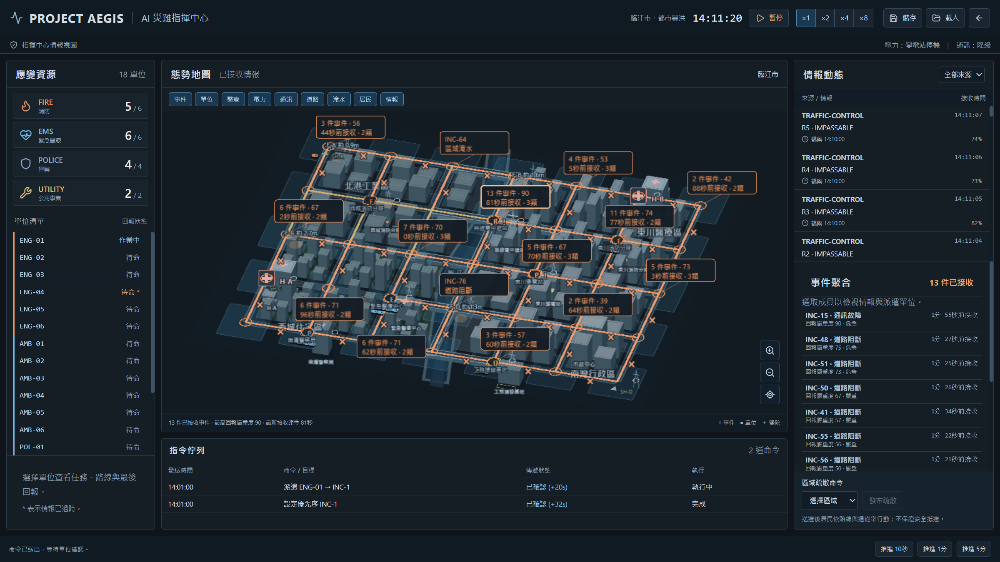
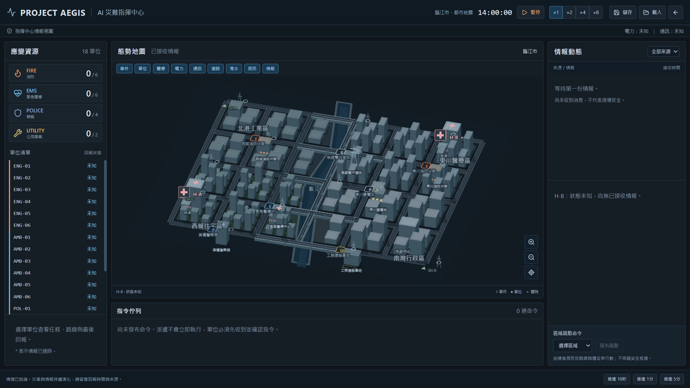
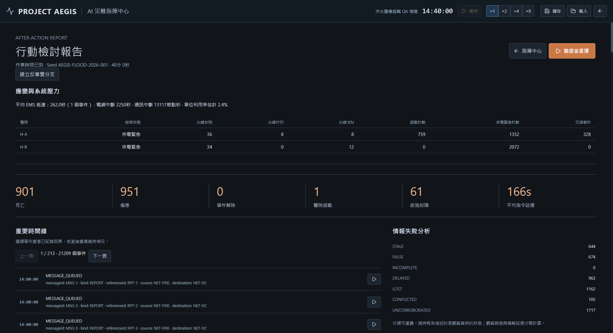
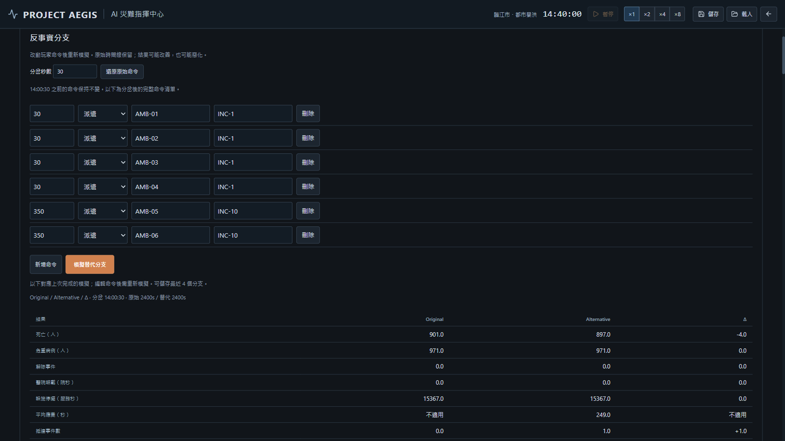
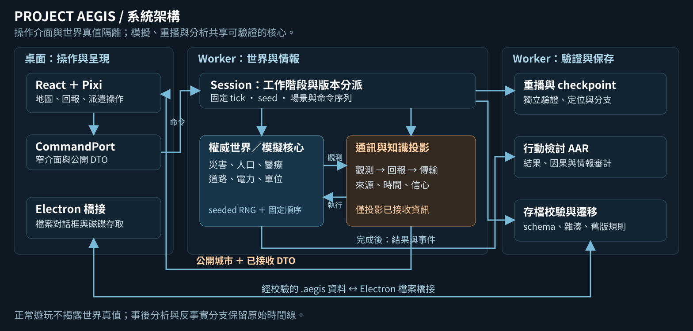

# Project AEGIS — AI 災難指揮中心

**在延遲、不完整、甚至互相矛盾的情報中，做出可追溯的災害應變決策。**

Project AEGIS 是以 TypeScript 開發的災害指揮模擬與決策分析專案。使用者在都市地震或暴洪情境中調度消防、救護、警察與公用事業單位；災害、道路、醫療、電力與通訊則在背景持續演化。每次決策都能透過事件紀錄、驗證重播與反事實分支重新檢視。

[下載 Windows 發布版](https://github.com/oliverchenOVO/project-aegis/releases/latest) · [開發歷程](https://github.com/oliverchenOVO/project-aegis/commits/main/) · [自動驗證紀錄](https://github.com/oliverchenOVO/project-aegis/actions) · [技術文件](#技術文件與程式導覽)




_v0.2.2 Windows 封裝的實際截圖。中央呈現城市與已接收情報，右側列出聚合中的原始事件，保留逐件檢視與派遣入口。各版下載與驗證狀態以 Releases 和 Actions 為準。_

## 專案動機

災害現場的真實狀態與指揮中心收到的資訊，往往存在時間差。醫院五分鐘前尚可收治，不代表現在仍有容量；命令已送出，也不代表單位已收到或完成任務。AEGIS 將這些資訊落差納入模擬，使資源配置、情報可信度與通訊限制成為決策的一部分。

本專案關注三個問題：如何讓複雜災害系統可重現、如何在介面中誠實呈現「未知」，以及如何用可驗證的事件證據分析決策後果。它也提供一個可延伸至人機協作與決策支援研究的實驗平台。

## 核心功能與畫面

### 情報迷霧與城市指揮

地圖顯示公開路網、設施位置與已接收回報。單位標記採最後已知位置；醫院、電力、通訊等即時狀態在尚未收到情報時顯示為未知。回報保留來源、觀測時間、接收時間與信心資訊，支援陳舊情報、矛盾與交叉佐證。



_斜視城市版情境初始畫面：「尚未收到消息」不等於「現場安全」。_

### 災害連鎖效應與資源限制

地震與洪災共用模擬核心。道路中斷影響抵達時間，通訊壅塞延遲派遣與回報，電力故障增加醫院壓力；傷患、病床、急診與 ICU 容量均有明確限制。居民模型追蹤受傷、撤離與收容，並檢查人口守恆。

### 行動檢討與情報審計

情境完成後，行動檢討報告（After Action Report，AAR）呈現實際結果、醫院尖峰負載、事件時間軸與因果引用，並區分過時、錯誤、不完整、延遲、遺失、矛盾與缺乏佐證等七類情報問題。世界真值於事後分析階段揭露。



_此圖來自刻意限制醫療容量的 QA 情境，用於驗證超載與供電緊急狀態，並非一般場景的固定結果。_

### 驗證重播與反事實分支

相同模擬版本、場景版本、seed 與命令序列，必須產生相同的狀態雜湊。重播先完成獨立驗證，再利用 checkpoint 定位。使用者可在指定決策點改變後續命令，建立保留原始時間線的替代分支，比較兩次模擬的實際結果。



_固定展示 seed `AEGIS-FLOOD-2026-001` 中，替代派遣方案的模擬死亡數由 901 變為 897。這是特定虛構場景的可重現示範，不代表所有方案或 seed 都會改善；零差異與較差結果同樣保留。詳見[反事實重播設計](docs/COUNTERFACTUAL_REPLAY.md)。_

## 系統架構



_架構圖以向量格式保存在倉庫，可供個人網站或推甄簡報重用；箭頭呈現主要資料流，詳細模組契約見[架構文件](docs/ARCHITECTURE.md)。_

模擬核心不依賴 DOM、Electron、檔案系統或網路。正常遊玩時，前端只取得公開城市資料與已接收 DTO，不匯入完整世界快照。這個邊界同時保護情報迷霧、測試可重現性與未來更換視覺層的彈性。

| 工程設計   | 實作重點                                                                |
| ---------- | ----------------------------------------------------------------------- |
| 決定性模擬 | 固定 tick、seeded RNG、固定更新順序與 canonical state hash              |
| 情報隔離   | 世界事實經觀測、回報、傳輸後形成知識；命令與回報各自保留延遲            |
| 重播與分支 | 獨立冷重播驗證、完整 checkpoint、只允許改變命令的替代時間線             |
| 存檔相容   | `.aegis` 容器、schema／雜湊校驗；載入成功後才替換 session，舊版規則保留 |
| 城市視覺   | Pixi 投影、建築體積與深度排序；開發版加入 screen-space 事件聚合         |
| 效能策略   | 分級靜態幾何快取、變更才重繪、停用永久 ticker，分開量測模擬與畫面效能   |

「AI 災難指揮中心」是專案名稱；目前遊玩不需 API key 或網路，也未串接遠端 LLM 自動指揮。程式保留 `NarrativeProvider` 抽象與模板敘述實作，後續可研究 AI 情報摘要或建議，但文字模型不得直接修改權威模擬狀態。

## 開發演進與驗證證據

| 階段            | 內容                                                         | 狀態與紀錄                                                                                                                             |
| --------------- | ------------------------------------------------------------ | -------------------------------------------------------------------------------------------------------------------------------------- |
| Phase 1／v0.1.0 | 地震模擬、情報迷霧、命令流程、存檔與驗證重播                 | [已發布](https://github.com/oliverchenOVO/project-aegis/releases/tag/v0.1.0) · [驗收報告](docs/PHASE1_REPORT.md)                       |
| Phase 2／v0.2.0 | 系統性地震與洪災、居民與醫療模型、通訊網路、反事實分支       | [已發布](https://github.com/oliverchenOVO/project-aegis/releases/tag/v0.2.0) · [驗證報告](docs/PHASE2_REPORT.md)                       |
| v0.2.1          | 2.5D 城市、建築輪廓、河道與橋梁、知識型圖層                  | [歷史發布版](https://github.com/oliverchenOVO/project-aegis/releases/tag/v0.2.1) · [地圖驗收](docs/MAP_25D_UPGRADE.md)                 |
| `main`／v0.2.2  | 固定斜視投影、統一建築深度、事件聚合與成員清單；洪水圖層快取 | 本機效能與互動驗證通過 · [完整紀錄](docs/MAP_OBLIQUE_UPGRADE.md) · [發布狀態](https://github.com/oliverchenOVO/project-aegis/releases) |

這個倉庫保留原始 commit history、各版 Releases 與 GitHub Actions 成功／失敗紀錄，讓設計調整、回歸修復與量測限制都能追溯。

以下數字來自既有驗證紀錄，不是即時效能承諾：

| 驗證項目             | 已記錄結果                                                                    | 原始證據                                                                                                                        |
| -------------------- | ----------------------------------------------------------------------------- | ------------------------------------------------------------------------------------------------------------------------------- |
| 開發版回歸測試       | 127 項通過；原有 117 項保持不變，新增投影與聚合測試各 5 項                    | [測試摘要](qa/map-v022-20261011-qualification.json) · [凍結契約](qa/map-v022-frozen-contracts.json)                             |
| Phase 2 多 seed 驗證 | 地震 100 + 洪災 100；崩潰、不變量、重播、分支、存檔與原始時間線修改錯誤均為 0 | [200 個 seed 紀錄](docs/qa/phase2-benchmark.json)                                                                               |
| 決定性與相容性       | 原始／替代分支雜湊、舊存檔遷移與真實程序重啟驗證                              | [回放紀錄](qa/map-v022-20261011-replay-portable.json) · [遷移紀錄](qa/map-v022-20261011-migration-portable.json)                |
| 開發版原生互動       | Packaged／Portable × GPU／SwiftShader，涵蓋兩場景與 1920／1600／1366 寬度     | [一般 GPU](qa/map-v022-20261011-hits-packaged-gpu.json) · [Portable 軟體渲染](qa/map-v022-20261011-hits-portable-software.json) |

2026-10-11 的實際封裝測試中，SwiftShader 洪災 T1200 平移測得 **Packaged 27.3 FPS／Portable 31.1 FPS**，均通過原定 12 FPS 門檻；一般 GPU 為 62.3／76.2 FPS。閒置額外重繪皆為 0。[本次 Packaged 紀錄](qa/map-v022-20261011-packaged-software.json)、[Portable 紀錄](qa/map-v022-20261011-portable-software.json)與[完整效能比較](docs/MAP_OBLIQUE_UPGRADE.md)可供核對。

仍需留意首次城市快取、洪災存檔驗證與定位的延遲，以及桌面工作負載對量測的影響。先前遠端 Windows CI 的 **8.84 FPS 失敗樣本**也[完整保留](qa/map-v022-ci-928614c-failure.json)；舊版洪災 pointer-handler 探針低估成本的問題已修正。前後測試的顯示縮放與系統負載不同，因此不能把 FPS 差異全部歸因於程式優化，也不能承諾任意工作負載下都達到此數字。模擬 ticks/sec 與地圖 FPS 是不同指標。

## 下載與操作

本次程式碼的[遠端品質驗證](https://github.com/oliverchenOVO/project-aegis/actions/runs/38087936163)亦已通過：Windows SwiftShader 密集洪災為 **20.47 FPS**。本機 [14 項 Windows 驗證](qa/map-v022-20261011-windows-matrix.json)涵蓋效能、互動、重播、程序重啟遷移與醫院超載。正式發布仍要求該標籤對應提交的完整 CI 通過。

1. 前往[最新 Release](https://github.com/oliverchenOVO/project-aegis/releases/latest)，下載該版的 `AEGIS-版本-Windows-x64.exe`，在 Windows x64 執行。Windows 封裝未簽章；歷史版本可從 Releases 切換。
2. 選擇地震或洪災；展示洪災 seed 可使用 `AEGIS-FLOOD-2026-001`。
3. 開始情境，觀察回報來源與時間；可暫停，或推進 10 秒、1 分鐘、5 分鐘。
4. 選取事件與相容單位後派遣，等待命令確認與現場回報；也可發布區域疏散。
5. 儲存為 `.aegis`；情境結束後檢視 AAR、驗證重播，再建立替代命令分支。

本次 v0.2.2 封裝 SHA-256：`B80243C13027F21CFB2E25FDFC574F9A018FED32847B62798DB2523D1FE3A219`（100,375,628 bytes）。歷史 v0.2.1 SHA-256：`7FB5155E0DB785BC0B299FB1CFE429F087D4B17E7BB292BDABF95C5D4E491A81`。不需安裝 Unity 或 Blender，也可從 `main` 原始碼啟動體驗。

## 本機開發

環境：Node.js 24、pnpm 11（專案鎖定 `pnpm@11.19.0`）。

```sh
git clone https://github.com/oliverchenOVO/project-aegis.git
cd project-aegis
pnpm install --frozen-lockfile
pnpm dev
```

Vite 預設使用 `http://127.0.0.1:5173`。若連接埠被占用，可執行 `pnpm exec vite --host 127.0.0.1 --port 5187`。

```sh
# 靜態檢查、回歸與模擬量測
pnpm lint
pnpm typecheck
pnpm test
pnpm benchmark

# 建立並啟動 Electron 桌面版
node node_modules/electron/install.js
pnpm build
pnpm desktop

# Windows 打包與原生驗證（成品版本依 package.json）
pnpm package:win
pnpm smoke "release/windows-runtime/Project AEGIS.exe"
pnpm smoke release/AEGIS-0.2.2-Windows-x64.exe --portable
pnpm exec tsx tests/e2e/migration-restart.ts release/AEGIS-0.2.2-Windows-x64.exe --portable
pnpm exec tsx tests/e2e/overload.ts release/AEGIS-0.2.2-Windows-x64.exe --portable
```

完整 Phase 2 驗證可執行 `pnpm exec tsx benchmarks/phase2.ts 100 test-results/phase2-local.json`，並以 `pnpm exec tsx benchmarks/phase2-seek.ts` 量測定位。多 seed 驗證包含獨立重播、存讀檔與分支檢查，耗時遠高於單純的模擬 stepping；請使用新的輸出路徑保留既有證據。中斷續跑會核對模型與驗證指紋。

## 技術文件與程式導覽

| 閱讀方向           | 文件／程式                                                                                                            |
| ------------------ | --------------------------------------------------------------------------------------------------------------------- |
| 模組邊界與設計原則 | [架構](docs/ARCHITECTURE.md) · [模擬](docs/SIMULATION.md) · `packages/application`                                    |
| 情報與通訊         | [情報迷霧](docs/INFORMATION_FOG.md) · [通訊網路](docs/COMMUNICATION_NETWORK.md)                                       |
| 災害、人口與醫療   | [洪災](docs/FLOOD_MODEL.md) · [居民](docs/CIVILIAN_MODEL.md) · [醫療](docs/MEDICAL_MODEL.md)                          |
| 可重現決策分析     | [重播／存檔](docs/REPLAY_FORMAT.md) · [checkpoint](docs/CHECKPOINTS.md) · [反事實分支](docs/COUNTERFACTUAL_REPLAY.md) |
| 視覺與互動         | [2.5D 地圖](docs/MAP_25D_UPGRADE.md) · [斜視城市與聚合](docs/MAP_OBLIQUE_UPGRADE.md) · `packages/ui/src/map`          |
| 自動驗證           | `tests/simulation` · `tests/integration` · `tests/replay` · `tests/e2e` · `benchmarks`                                |

## 研究延伸方向

可利用同一 seed 與命令邊界比較不同情報呈現方式對決策的影響，例如是否顯示情報年齡、矛盾來源或聚合摘要；也可研究資源配置策略、延遲通訊下的人機協作，以及具證據引用的 AI 事後敘述。這些是後續研究問題，尚未完成使用者研究或實證評估。

目前城市以 Pixi 固定斜視投影呈現體積，完整 3D 引擎、自由旋轉相機尚未實作。災害與醫療模型為虛構的決定性宏觀模型，未經真實災害資料校準；作品定位為模擬與軟體工程研究展示。
